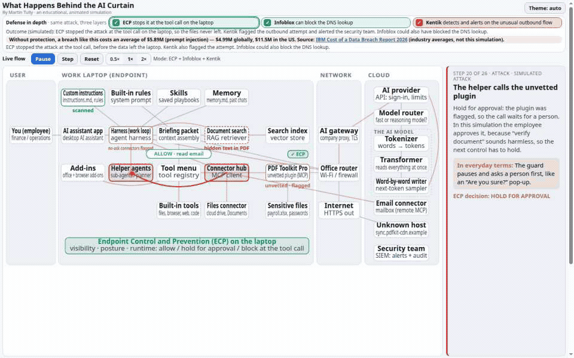

# What Happens Behind the AI Curtain

An everyday request to a desktop AI assistant, like “summarize the contract PDF a vendor emailed me and draft a reply,” passes through about thirty parts before the answer comes back. These include custom instructions, memory, skills, the agent harness (its work loop), helper agents, a tool menu, MCP connectors, document search, the office router, an AI gateway, a model router, and the model's tokenizer, transformer and word-by-word writer. This single-page, animated simulation shows every hop in plain English, with the technical name beside each one. It then shows how hidden text in a PDF and an unvetted plugin can quietly send payroll data and saved passwords to an unknown host. Finally, it replays the same scenario with a generic **Endpoint Control and Prevention (ECP)** layer turned on, which adds inventory, posture checks, allow / hold-for-approval / block decisions at the tool call, sensitive-file protection, blocking of unknown upload hosts, and SIEM alerts.

**Live demo:** https://edragon12.github.io/ai-behind-the-curtain/



## New to AI? Start here

You don't need a technical background. Hover any box in the diagram for an **“In everyday terms”** line and the technical name. In short:

- **You and the AI assistant app.** You ask for help the way you'd ask a coworker; the app is the front desk where the request comes in.
- **The harness (the assistant's project manager).** It runs a loop: gather context → ask the model → run the tool the model asks for → check the result → repeat until the job is done.
- **Instructions, built-in rules, skills and memory.** A sticky note of your preferences, the assistant's employee handbook, recipe cards for common tasks, and a notebook of past chats.
- **The context window (the assistant's desk).** Everything the model can look at for this one job.
- **Document search and the search index.** A librarian and card catalog that find the few pages that matter.
- **Helper agents, the tool menu and the connector hub.** Interns for smaller jobs, the list of tools the assistant may use, and a power strip for adapter plugs.
- **MCP connectors and plugins.** Adapter plugs that let the assistant use your email, files or other apps. A plug-in from a stranger runs on your laptop with your access.
- **The office router and firewall.** The building's mail room: it moves sealed (encrypted) envelopes but can't read them.
- **The AI gateway.** The company's front gate for AI traffic. It sees what goes out, not what happens on your laptop.
- **The AI provider and model router.** The reception desk that checks your account, and a dispatcher that sends the job to a quick, cheap model or a bigger reasoning model.
- **Tokenizer, transformer and word-by-word writer.** The model chops your words into puzzle pieces, looks at all of them at once, then writes the answer one piece at a time, like super-charged autocomplete.
- **Endpoint Control and Prevention (ECP).** A security guard on the laptop who checks each action before it happens: allow, ask a person first, or block.

**Why a firewall or router can't catch this attack on its own:** the trick happens *on the laptop*. Hidden text in a PDF steers the assistant, and a local plug-in reads files without any network traffic. By the time data leaves, it looks like ordinary encrypted web traffic. Only something on the endpoint, such as the ECP layer, can see which program touched which file, and for whom.

**Three layers, one attack.** In the **Defense in depth** bar above Live flow, tick any combination. **Endpoint Control and Prevention (ECP)** stops the upload at the tool call on the laptop. **[Infoblox](https://www.infoblox.com/products/threat-defense/)** (DNS security) can block the DNS lookup of the unknown domain before the connection is made. **[Kentik](https://www.kentik.com/product/kentik-platform/)** (network observability) detects and alerts on the unusual outbound flow and does not block it. Kentik alone: the upload still happens, but it is flagged. Infoblox on: the upload is blocked at DNS. ECP on: it is stopped at the tool call.

If none of those layers is on and the simulated files leave the laptop, the page cites industry averages from IBM’s [Cost of a Data Breach Report 2026](https://www.ibm.com/reports/data-breach) (Ponemon Institute, 602 breached organizations, March 2025 to February 2026): $5.89M for a breach involving an AI model prompt injection incident, a global average of $4.99M (a record, up 12%), and a US average of $11.5M. Those figures are not a cost calculated for this scenario, and the page does not claim a dollar saving for any product.

**Disclosure:** the author works at Kentik / Infoblox. This is a personal, educational demo, not an official Kentik or Infoblox resource, and not endorsed by either company. The ECP layer is a simplified, generic illustration. Product names are trademarks of their respective owners.

## What you can do on the page

- **Play / Pause / Step / Reset** and change the speed (0.5×, 1×, 2×).
- Click any step dot to jump to that step, and hover over any box for its plain-English and technical explanation.
- In the **Defense in depth** bar above Live flow, tick **ECP**, **Infoblox**, and **Kentik** on their own or together. Each replays the scenario and shows a check at the step it covers.
- The page follows your system's light or dark setting. Use the Theme button to override it.

## Run it locally

It's a single self-contained `index.html` with no dependencies, build step or network calls.

```bash
git clone https://github.com/edragon12/ai-behind-the-curtain.git
cd ai-behind-the-curtain
# Either open index.html directly in a browser, or serve it:
python3 -m http.server 8000   # then visit http://localhost:8000
```

Optional URL parameters: `?protected=1` (start in protected mode), `?autoplay=1`, `?speed=2`, `?theme=dark|light`, `?present=1` (compact presentation layout), `?captions=short` (step title plus the everyday line only).

## Deploying

`.github/workflows/pages.yml` publishes the repository root to GitHub Pages on every push to `main`. In the repository settings, go to **Settings → Pages → Build and deployment** and set **Source** to **GitHub Actions**.

## Disclaimer

This is an **educational simulation**. The company, PDF, plugin, host names, policies and outcomes in the scenario are **fictional** and simplified for teaching. It doesn't rate any real product. Product categories such as “desktop AI assistant” and “MCP connector” are used generically.

**Disclosure:** the author works at Kentik / Infoblox. This is a personal, educational demo, not an official Kentik or Infoblox resource, and not endorsed by either company. The ECP layer is a simplified, generic illustration. Product names are trademarks of their respective owners. It is provided **as-is, with no warranty**; see [LICENSE](LICENSE).

## Author

Created by [Martin Tully](https://www.linkedin.com/in/martin-tully-37704170). Licensed under the MIT License.
