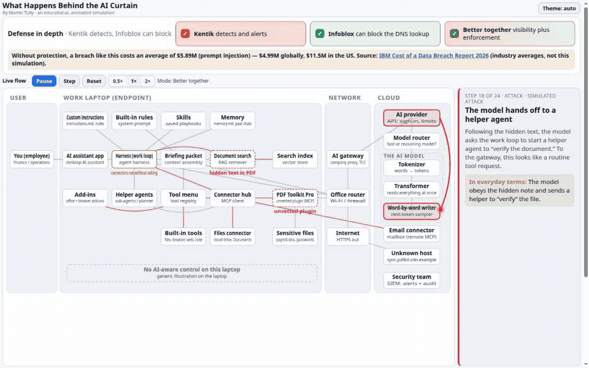

# What Happens Behind the AI Curtain

An everyday request to a desktop AI assistant, like “summarize the contract PDF a vendor emailed me and draft a reply,” can be steered by hidden text in a PDF and a third-party plugin, and can send payroll data and saved passwords to an unknown host. **Better together:** Kentik sees the unusual outbound flow in NetFlow and the firewall or proxy syslog, and alerts. Infoblox can stop the name lookup at DNS. That is visibility plus enforcement. Kentik does not block. The page still walks every hop in plain English.

**Live demo:** https://edragon12.github.io/ai-behind-the-curtain/



## New to AI? Start here

You don't need a technical background. Hover any box in the diagram for an **“In everyday terms”** line and the technical name. In short:

- **You and the AI assistant app.** You ask for help the way you'd ask a coworker; the app is the front desk where the request comes in.
- **The harness (the assistant's project manager).** It runs a loop: gather context → ask the model → run the tool the model asks for → check the result → repeat until the job is done.
- **Instructions, built-in rules, skills and memory.** A sticky note of your preferences, the assistant's employee handbook, recipe cards for common tasks, and a notebook of past chats.
- **The context window (the assistant's desk).** Everything the model can look at for this one job.
- **Document search and the search index.** A librarian and card catalog that find the few pages that matter.
- **Helper agents, the tool menu and the connector hub.** Interns for smaller jobs, the list of tools the assistant may use, and a power strip for adapter plugs.
- **MCP connectors and plugins.** Adapter plugs that let the assistant use your email, files or other apps. A plug-in from a stranger runs on your laptop with your access.
- **The office router and firewall.** The building's mail room: it moves sealed (encrypted) envelopes but can't read them.
- **The AI gateway.** The company's front gate for AI traffic. It sees what goes out, not what happens on your laptop.
- **The AI provider and model router.** The reception desk that checks your account, and a dispatcher that sends the job to a quick, cheap model or a bigger reasoning model.
- **Tokenizer, transformer and word-by-word writer.** The model chops your words into puzzle pieces, looks at all of them at once, then writes the answer one piece at a time, like super-charged autocomplete.

**Why a firewall or router can't catch this attack on its own:** the trick happens *on the laptop*. Hidden text in a PDF steers the assistant, and a local plug-in reads files without any network traffic. By the time data leaves, it looks like ordinary encrypted web traffic.

**Better together.** In the **Defense in depth** bar above Live flow, **[Kentik](https://www.kentik.com/product/kentik-platform/)** sees the unusual outbound flow in NetFlow and the firewall or proxy syslog, and alerts. It does not block. **[Infoblox](https://www.infoblox.com/products/threat-defense/)** can stop the DNS lookup. **Better together** turns both on: visibility plus enforcement. Unchecking either one clears Better together.

The page always shows what a breach like this costs without protection, using industry averages from IBM’s [Cost of a Data Breach Report 2026](https://www.ibm.com/reports/data-breach) (Ponemon Institute, 602 breached organizations, March 2025 to February 2026): $5.89M for a breach involving an AI model prompt injection incident, a global average of $4.99M (a record, up 12%), and a US average of $11.5M. Those figures are not a cost calculated for this scenario. At the end of a run the step panel states the outcome once. When a layer was on, that panel also says what this simulation does with no protection: the payroll file and saved passwords reach the unknown host, no alert fires, and the employee sees a normal summary, plus the kind of office disruption that often follows. No dollar saving is claimed for any product, and no cost is invented beyond the IBM averages above.

**Disclosure:** the author works at Kentik / Infoblox. This is a personal, educational demo, not an official Kentik or Infoblox resource, and not endorsed by either company. Product names are trademarks of their respective owners.

## What you can do on the page

- **Play / Pause / Step / Reset** and change the speed (0.5×, 1×, 2×).
- Click any step dot to jump to that step, and hover over any box for its plain-English and technical explanation.
- In the **Defense in depth** bar above Live flow, tick **Kentik**, **Infoblox**, or **Better together**. Each replays the scenario. Unchecking Kentik or Infoblox clears Better together.
- The page follows your system's light or dark setting. Use the Theme button to override it.

## Run it locally

It's a single self-contained `index.html` with no dependencies, build step or network calls.

```bash
git clone https://github.com/edragon12/ai-behind-the-curtain.git
cd ai-behind-the-curtain
python3 -m http.server 8000
```

Then open http://localhost:8000. Or just open index.html directly in a browser.

Optional URL parameters: `?protected=1` (start in protected mode), `?autoplay=1`, `?speed=2`, `?theme=dark|light`, `?present=1` (compact presentation layout), `?captions=short` (step title plus the everyday line only).

## Deploying

`.github/workflows/pages.yml` publishes the repository root to GitHub Pages on every push to `main`. In the repository settings, go to **Settings → Pages → Build and deployment** and set **Source** to **GitHub Actions**.

## Disclaimer

This is an **educational simulation**. The company, PDF, plugin, host names, policies and outcomes in the scenario are **fictional** and simplified for teaching. It doesn't rate any real product. Product categories such as “desktop AI assistant” and “MCP connector” are used generically.

**Disclosure:** the author works at Kentik / Infoblox. This is a personal, educational demo, not an official Kentik or Infoblox resource, and not endorsed by either company. Product names are trademarks of their respective owners. It is provided **as-is, with no warranty**; see [LICENSE](LICENSE).

## Author

Created by [Martin Tully](https://www.linkedin.com/in/martin-tully-37704170). Licensed under the MIT License.
